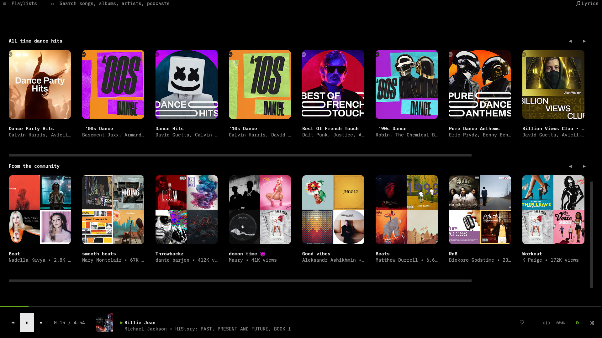
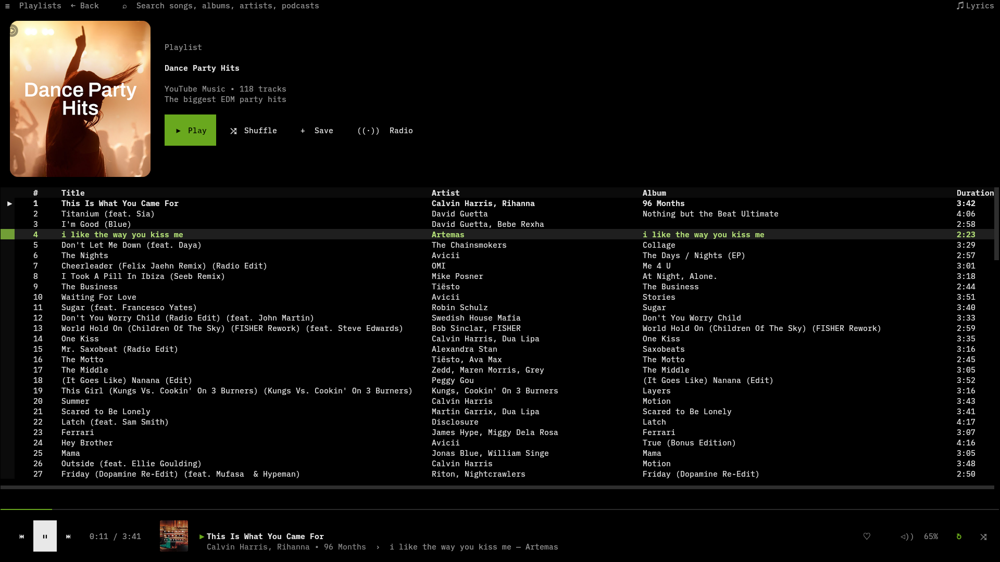
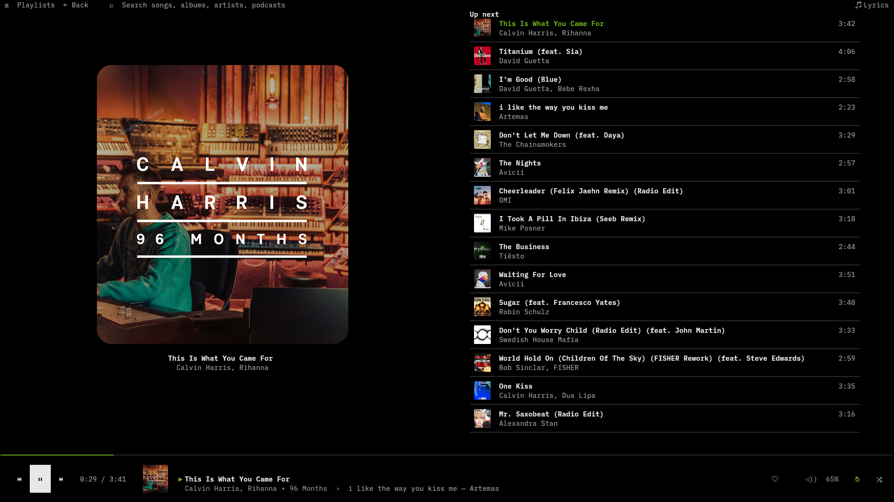
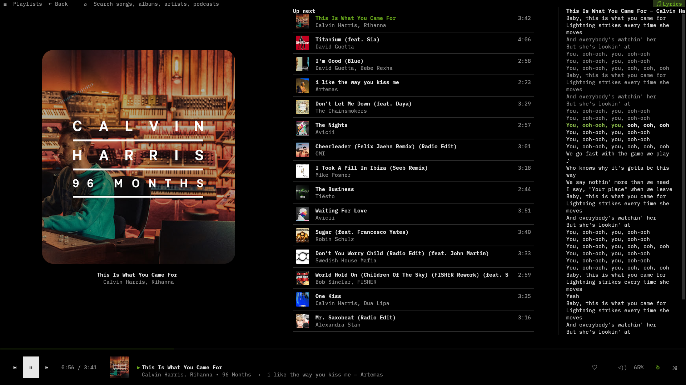

<p align="center">
  
</p>

<p align="center">
  <a href="https://ytm-player.com"></a>
</p>

<p align="center">
  <a href="https://pypi.org/project/ytm-player/"></a>
  <a href="https://www.python.org/downloads/"></a>
  <a href="https://github.com/peternaame-boop/ytm-player/actions/workflows/ci.yml"></a>
  <a href="https://github.com/peternaame-boop/ytm-player/blob/master/LICENSE"></a>
</p>

<p align="center">
  <a href="#install"></a>&nbsp;
  <a href="#quickstart"></a>&nbsp;
  <a href="#documentation"></a>&nbsp;
  <a href="https://github.com/peternaame-boop/ytm-player/blob/master/CONTRIBUTING.md"></a>&nbsp;
  <a href="https://github.com/peternaame-boop/ytm-player/blob/master/CHANGELOG.md"></a>
</p>

---


> Available on **PyPI**, **AUR**, **NixOS**, and **Gentoo** — actively maintained with cross-platform support.

## Look of this fork

This fork restyles the TUI after the YouTube Music web player. Kitty draws real cover art through
the graphics protocol. The captures below use kitty with IBM Plex Mono, with the playlist sidebar
collapsed.

**Home, scrolled to the last shelves.** Each shelf is a row of rounded covers with the title and
the artist below. A thin scroll line runs under each row.



**Playlist.** A hero with the cover, the track count, and Play, Shuffle, Save and Radio sits
above the track table. The table is pure black. The current row and the playing track are
dim green.



**Now playing.** The large cover sits on the left. Up next sits in the middle of the right half:
each row has a small cover, a bold title over the artist, and the duration. Click a row to play it.



**Lyrics.** Synced lines light word by word. YouTube times lines only, so each word gets a share
of the line's time by its length, and it lights 1 s early.



**Player bar.** The bar follows the web player:

- The seek line on top is the progress bar. Under the mouse it grows into a band you can click to seek, with a time tooltip.
- Left: previous, play, next and the time.
- Middle: the cover and the title as one block, with the focused row after a › when it fits.
- Right: like, volume, repeat and shuffle. Icons are grey when off and theme green when on.

Volume, shuffle, repeat, the lyrics panel and album art persist across runs. See `remember_layout` in [docs/configuration.md](docs/configuration.md).

## Features

- **Vim-style keybindings** — j/k movement, multi-key sequences (`g s` for search, `g l` for library), count prefixes (`5j`)
- **Synced lyrics** — live-highlighted with LRCLIB fallback for tracks YouTube doesn't have, with title sanitization for better LRCLIB matches
- **mpv backend** — gapless audio, stream prefetching, broad codec support
- **Cross-platform native integrations** — MPRIS (Linux), Now Playing (macOS), media keys (Windows)
- **Theming** — 18+ Textual themes plus per-app color overrides in `theme.toml`
- **Spotify import** — pull playlists in via API or scraper fallback
- **CLI + IPC** — control a running TUI from another terminal (`ytm play`, `ytm pause`, etc.)
- **Free-tier support** — works without YouTube Music Premium
- **Session resume** — last-playing track + queue restored on launch
- **Local cache** — LRU audio cache for offline-like replay of previously heard tracks
- **Discord + Last.fm** — Rich Presence and scrobbling

## Requirements

- **Python 3.10+**
- **[mpv](https://mpv.io/)** (audio playback backend, must be installed system-wide)
- A YouTube Music account (free or Premium)

## Install

```bash
# PyPI (Linux / macOS / Windows)
pip install ytm-player

# Arch / CachyOS / Manjaro (AUR)
yay -S ytm-player-git
```

For NixOS, Gentoo, Windows-specific mpv DLL setup, source builds, and optional extras (Discord, Last.fm, Spotify import, etc.), see [docs/installation.md](https://github.com/peternaame-boop/ytm-player/blob/master/docs/installation.md).

## Quickstart

```bash
ytm setup    # one-time auth (auto-detects browser cookies)
ytm          # launch the TUI
```

Windows: replace `ytm` with `py -m ytm_player`.

## Documentation

| Topic | Link |
|-------|------|
| Per-platform install + optional extras | [docs/installation.md](https://github.com/peternaame-boop/ytm-player/blob/master/docs/installation.md) |
| `config.toml` + `theme.toml` reference | [docs/configuration.md](https://github.com/peternaame-boop/ytm-player/blob/master/docs/configuration.md) |
| Full keyboard + mouse keybindings | [docs/keybindings.md](https://github.com/peternaame-boop/ytm-player/blob/master/docs/keybindings.md) |
| All `ytm` CLI subcommands | [docs/cli-reference.md](https://github.com/peternaame-boop/ytm-player/blob/master/docs/cli-reference.md) |
| Spotify playlist import | [docs/spotify-import.md](https://github.com/peternaame-boop/ytm-player/blob/master/docs/spotify-import.md) |
| Troubleshooting (mpv / auth / MPRIS / macOS / cache) | [docs/troubleshooting.md](https://github.com/peternaame-boop/ytm-player/blob/master/docs/troubleshooting.md) |
| File layout + stack | [docs/architecture.md](https://github.com/peternaame-boop/ytm-player/blob/master/docs/architecture.md) |
| Contributing | [CONTRIBUTING.md](https://github.com/peternaame-boop/ytm-player/blob/master/CONTRIBUTING.md) |
| Security policy | [SECURITY.md](https://github.com/peternaame-boop/ytm-player/blob/master/SECURITY.md) |

## Contributors

Thanks to [@dmnmsc](https://github.com/dmnmsc), [@Villoh](https://github.com/Villoh), [@valkyrieglasc](https://github.com/valkyrieglasc), [@dsafxP](https://github.com/dsafxP), [@Thayrov](https://github.com/Thayrov), [@glywil](https://github.com/glywil), [@Kineforce](https://github.com/Kineforce), [@CarterSnich](https://github.com/CarterSnich), [@Tohbuu](https://github.com/Tohbuu), [@nitsujri](https://github.com/nitsujri), [@uhs-robert](https://github.com/uhs-robert), [@moschi](https://github.com/moschi), [@firedev](https://github.com/firedev), [@wgordon17](https://github.com/wgordon17), [@gitiy1](https://github.com/gitiy1), [@hanandewa5](https://github.com/hanandewa5), [@aimar-a](https://github.com/aimar-a), [@Gimar250](https://github.com/Gimar250), [@Wiibleyde](https://github.com/Wiibleyde), [@szx19970521](https://github.com/szx19970521), [@aaguilar-hub](https://github.com/aaguilar-hub), [@TheoBassaw](https://github.com/TheoBassaw), [@holstvoogd](https://github.com/holstvoogd), and [@ProfessionalGriefer](https://github.com/ProfessionalGriefer) for bug reports, fixes, packaging, and platform support.

## Changelog

See [CHANGELOG.md](https://github.com/peternaame-boop/ytm-player/blob/master/CHANGELOG.md) for the full release history.
